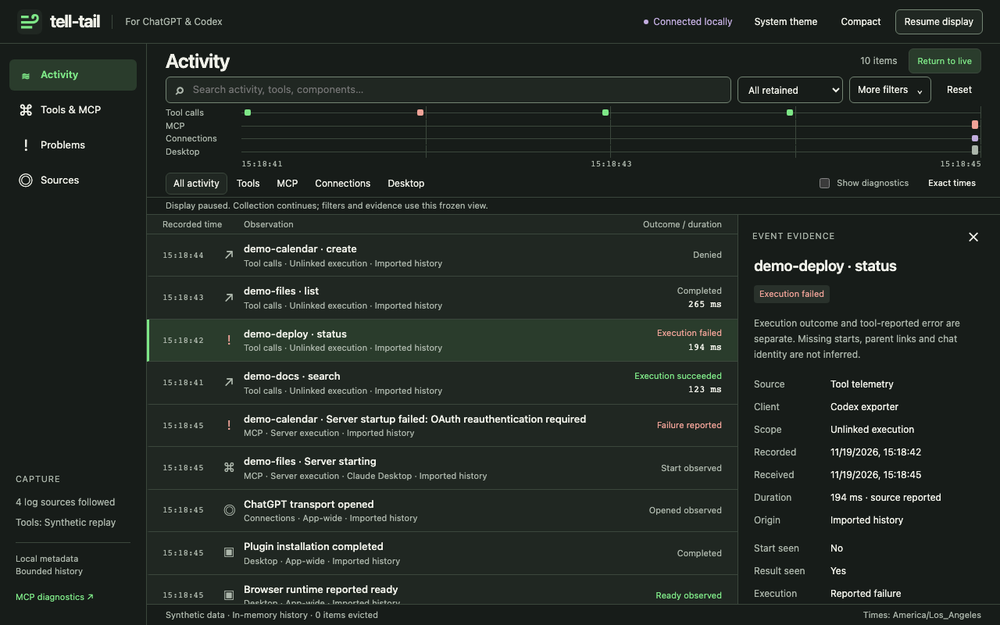

# Tell-Tail · AI Activity

Available in this source checkout; not included in published 0.4.0 binaries.
The AI Activity workspace combines supported local desktop observations, MCP
server diagnostics, and opted-in Codex tool results. It does not read conversation
databases or claim to observe every ChatGPT cloud operation.



See the [implementation validation](VALIDATION-DESKTOP-ACTIVITY.md) for measured
limits, native migration evidence and live capture results.

## One Tell-Tail, two workspaces

Use the **Logs / AI Activity** switch beside the Tell-Tail name. ChatGPT and
Codex identify this integration, not a separate product. `/activity` opens the
activity workspace; `/logs` opens the original metrics dashboard with aggregate
counts from the desktop logs already followed. No second follower is started.
The metrics are based on complete record contents and source-reported severity;
AI Activity applies its own event semantics. Ordinary warning-level connection
closures can therefore contribute to Logs warnings without becoming Problems.

Desktop Logs includes imported history at receipt time. Its byte counts exclude
line endings, oversized records, partial records and unread bootstrap history;
raw previews and unavailable ingestion diagnostics are hidden. The Activity
Sources view retains follower/discovery diagnostics. General file/stdin launches
keep their original physical-byte counters, parsers and recent-error previews.
See [workspaces](WORKSPACES.md) for the full entry-point contract.

## Start with Activity

```sh
cargo run --locked -- desktop --open
# Synthetic desktop events, connections, MCP failures and tool results:
cargo run --locked -- desktop --demo --open
# Finite metadata-only NDJSON inspection:
cargo run --locked -- desktop --once --output json
```

`--open` opens the default browser once at startup. `--output web` prints the
local URL without opening a browser. The login service does not open browser
windows at login or after crashes. The plugin opens the URL from `tracing status`
when you request the dashboard. The root page is **Activity**; **Tools & MCP** is
one destination within it. `/mcp` keeps the existing detailed MCP dashboard.
The independent `tell-tail mcp` command and APIs remain compatible.

On macOS, discovery uses the existing Codex Desktop log roots. Default discovery
also includes supported Claude MCP logs; it does not implement a general Claude
activity adapter. To select a specific source or directory:

```sh
cargo run --locked -- desktop --source codex-desktop --log-dir /absolute/log/directory --open
```

Other platforms can use explicit directories containing supported log formats.
Files literally named `desktop` remain accessible as `./desktop` or after `--`.
Headless text and JSON work without the `web` feature; the dashboard and receiver
require it. Demo and trace replay read no client logs and cannot enable an intake.

## Find and inspect activity

- **Activity** starts with compact rows and a four-lane time navigator. Recorded
  source time positions observations on the chart; the feed uses stable ingestion
  order. Missing source time remains unknown. Late arrivals are labeled.
- **Tools & MCP** focuses the same workspace on plugin results and server
  diagnostics. Provider suggestions come from observed tool namespaces, not an
  installed-plugin inventory. Searches cover all retained items, including pages
  beyond the first 100 rows.
- **Problems** groups reported failures by available verified execution scope.
  Unknown scopes stay separate. Recovery requires affirmative, matching MCP
  evidence; a normal closure, silence, or successful transport is not a failure
  or proof of application health.
- **Sources** explains followed files, exporter state, unsupported records,
  skipped history, collector limits, rejected input and retained evidence.

Select a row to inspect its outcome, timing, provenance, and safe diagnostic
metadata. **Linked evidence** uses a shared local execution scope. **Nearby in
time** only compares timestamps and explicitly does not imply causation. No
cross-source chat identity is established by the current adapter.

Pause, inspection, keyboard focus on evidence, and scrolling into history hold a
fixed view. Counts, filters, time bins, source status and details share its
watermark while collection continues. **Return to live** explicitly updates it.
Expired history and collector restarts are explained rather than silently
substituting newer evidence. Connection status remains live while the display
is paused. History is in memory and resets when the collector restarts.

The inspector sits beside the feed on wide screens and becomes a modal on narrow
screens. Escape closes it and restores focus. Light, dark, system appearance,
compact rows, reduced motion, and an **Exact times** table are supported. Only
appearance preferences are saved in the browser; searches and evidence are not.

## What the desktop adapter recognizes

`desktop-log-v1` accepts an explicit component/event allowlist from the local
metadata audit. Unknown fields and raw message bodies are discarded before storage.

| Observations | Meaning and limits |
| --- | --- |
| Transport opened, closed, reconnect scheduled | App-wide connection observations; ordinary closure stays informational even when the log level is warning |
| Subscription established | Routine diagnostic; topic values discarded |
| Plugin installed, marketplace added/synchronized | Lifecycle observations; plugin identifiers and URLs discarded; no inferred installed inventory |
| Browser backend startup/ready | Separate observations; no invented attempt pairing or duration |
| Runtime dependency check started/finished | Separate runtime observations, not proof of all dependencies being healthy |
| Response routed | Routine diagnostic; allowlisted method and bounded reported duration; not model latency, tool execution, or chat state |
| Existing MCP events | Existing server lifecycle, failure, recovery and mirror handling retained |
| Codex OTLP tool results | Existing result-only capture and unknown-outcome semantics retained |

Routine diagnostics are hidden initially and can be included with **Show
diagnostics**. The audited records came from this local ChatGPT/Codex Desktop
installation. This is an adapter for observed log shapes, not a stable logging
API or proof of support for every ChatGPT app version or surface. See the
[metadata audit](validation/desktop-event-audit-2026-11-19.json) and
[tool capture guide](PLUGIN-TRACING.md).

## Persistent capture and migration

New `tracing enable` installations run the `desktop` collector. Existing owned
MCP installations migrate with the **new executable's** `tracing upgrade`:

```sh
cargo run --release --locked -- tracing upgrade
cargo run --release --locked -- tracing status
```

The migration preserves the credential, ports and client configuration. It
checks both receiver and activity health. Rollback restores the previous
executable **and launch command**. Failed activation restores that generation
automatically. Edited service definitions/exporters are preserved and refused.
Disabled installations stay disabled. No Codex restart is needed when its loaded
endpoint and credential remain unchanged. See [lifecycle details](PLUGIN-TRACING.md).

Installing/updating a plugin alone does not silently replace the collector. This
source implementation adds no beta package, version bump or publication.

## Developer contract

One filesystem follower feeds the MCP parser and the desktop adapter. The
activity bridge projects sanitized MCP deltas and samples bounded accepted tool
revisions on collector ticks without holding both stores' locks together.
Intermediate tool revisions can coalesce; `projection_gaps` discloses coalesced
or missed revisions. There is no second unbounded event queue.

Activity has its own schema and epoch. `/api/activity/snapshot` returns a
watermark and source frame. Pass `epoch` and `as_of` to `/items`, `/bins`,
`/problems`, `/sources`, and `/item/{id}` under `/api/activity`. Item cursors bind
the watermark and filters; changing either invalidates the cursor. A restarted
collector or expired view returns HTTP 410. Unknown/duplicate/invalid query
parameters return 400. `/events` is SSE with coalesced watermark notifications,
not raw event payloads. Existing loopback Host/Origin and connection limits apply.

Supported filters: `view`, `category`, `q`, `plugin`, `server`, `source`, `client`,
`scope`, `outcome`, `historical`, `since`, `until`, `diagnostics`. Source timestamps
are milliseconds; `since` is inclusive and `until` exclusive. IDs, watermarks,
byte offsets and cumulative source counters use decimal strings. Time bins and
matched counts are bounded numeric values. Detail rows retain provenance and
qualified outcomes. NDJSON emits versioned `activity_item`, `activity_sources`
and explicit `activity_gap` envelopes.

Retention caps: 1,000 current items per category, 256 routine diagnostics, 8,000
revisions, 128 source frames, 4 KiB per normalized item, and a conservative 24 MiB
activity-store charge. Existing MCP/trace stores have separate bounds. Shared
bootstrap reads at most 2 MiB per file and 16 MiB total, across at most 64 followed
files. Evictions can expire frozen views even when the selected item remains
current. Pages contain at most 100 rows and 48 KiB of row data; failure group
responses disclose omitted groups. Source frames are capped at 32 KiB. These
are bounded local diagnostic views, not durable audit storage.

Run the Rust feature matrix and browser tests described in
[dashboard validation](TESTING-DASHBOARDS.md). The finite
`scripts/activity_benchmark.py` exercises mixed input, bootstrap and burst load.
The two existing 24-hour soaks remain optional and non-blocking.
